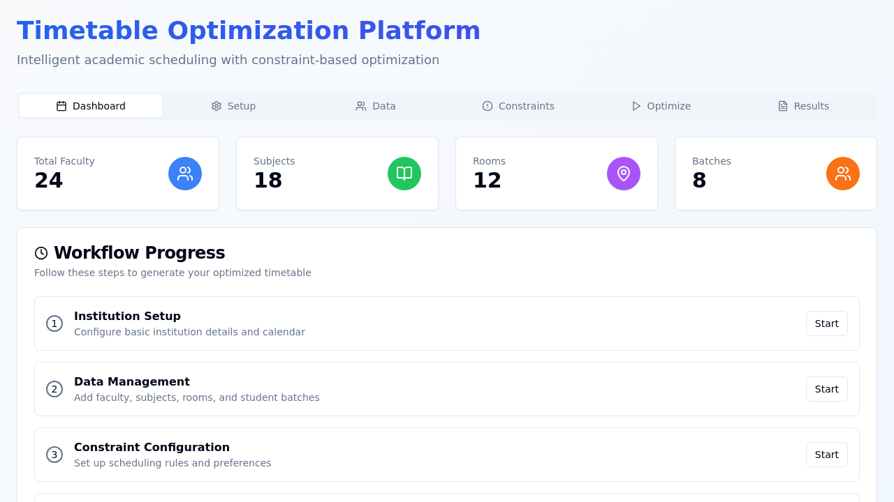

<div align="center">

# Smart Classroom & Timetable Scheduler

### Constraint-aware academic timetable generation — React + TypeScript




</div>

---

## 📖 Overview

The **Smart Classroom & Timetable Scheduler** is a web platform for building academic
timetables without spreadsheet chaos. Configure your institution (days, periods, breaks),
register subjects, faculty, rooms and batches, declare your constraints — then generate,
review and publish conflict-free schedules, exporting them as **PDF, Excel or CSV**.

It is a **fully client-side** app: no backend, no account. Everything lives in the browser via
`localStorage`, so it works offline and on any machine.

## ✨ Features

- **Institution Setup** — working days, period structure, breaks and semester dates
- **Data Management** — subjects (theory/lab), faculty, rooms and student batches
- **Constraint Manager** — hard and soft constraints (no double-booking, room capacity, …)
- **Timetable Optimizer** — per-class generation with:
  - **conflict prevention** against already-saved timetables
  - **pattern-avoidance heuristics** so schedules don't collapse into repetitive blocks
  - **randomized seeds** — regenerate to get alternative valid layouts
- **Timetable Viewer** — approve, publish and inspect generated schedules
- **Exports** — PDF and Excel for whole timetables, plus **dedicated lab-schedule CSVs**
  (simple "which batch, which subject, which lab" view and per-labroom listings)

## 🛠️ Tech Stack

- React + TypeScript, Vite, Tailwind CSS, **shadcn/ui** component kit, lucide-react icons
- Exporters: jspdf, jspdf-autotable, xlsx (+ custom CSV lab exporters in the engine)
- State: React hooks + `localStorage` persistence
- Package management: **pnpm** (workspace lockfile included)

## 📁 Repository Layout

```
Smart_Classroom_And_TimeTable_Scheduler/
├── shadcn-ui/                  # The application
│   └── src/
│       ├── components/         # InstitutionSetup, DataManagement, ConstraintManager,
│       │                       # TimetableOptimizer, TimetableViewer (+ ui kit)
│       ├── lib/timetableEngine.ts   # Generation logic + lab-schedule CSV exporters
│       ├── types/timetable.ts  # Shared domain types
│       └── pages/              # Index + 404
├── build/v1/                   # Pre-built static production bundle (open index.html)
├── cover/                      # Project cover art
├── LICENSE
└── README.md
```

## 🚀 Getting Started

```bash
git clone https://github.com/princekumar-dev/Smart_Classroom_And_TimeTable_Scheduler.git
cd Smart_Classroom_And_TimeTable_Scheduler
pnpm install

cd shadcn-ui
pnpm dev                       # http://localhost:5173
```

> npm/yarn also work (`npm install` inside `shadcn-ui/`), but pnpm is the configured manager.

**No build step?** A ready-made static bundle is committed at [`build/v1/`](build/v1/) — serve
that folder with any static server for a quick preview.

## 🕹️ How to Use

1. **Institution Setup** — define days, periods, breaks and term dates
2. **Data Management** — add subjects, faculty, rooms and batches
3. **Constraint Manager** — declare hard/soft rules
4. **Timetable Optimizer** — pick a class/batch and generate (re-run for alternative layouts)
5. **Timetable Viewer** — approve, publish and export PDF / Excel / lab CSVs

## 📄 License

See [LICENSE](LICENSE).

## 👤 Author

**Prince Kumar** — [@princekumar-dev](https://github.com/princekumar-dev)

---

<div align="center">
<sub><b>Smart Classroom & Timetable Scheduler</b> — constraints in, conflict-free schedules out.</sub>
</div>
